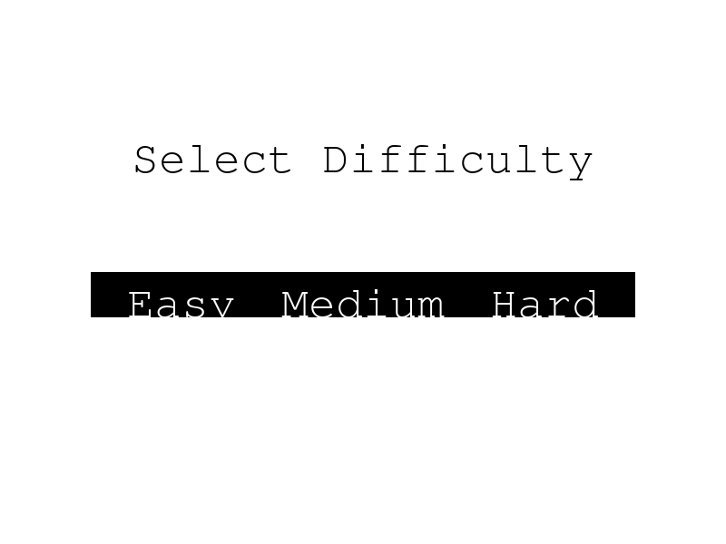
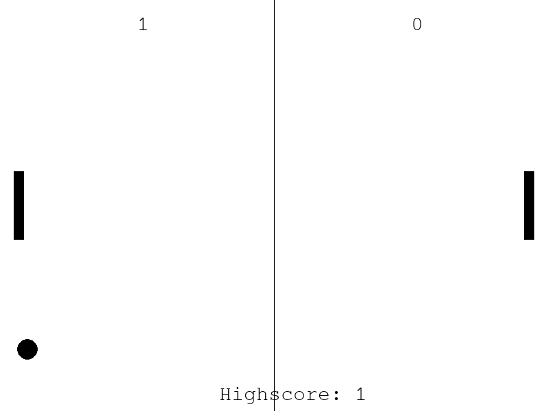

# Pong 1v1 – controlat prin gesturi

Versiune modernă a jocului Pong, în care paletele se controlează cu mâinile, prin camera web. Mâna stângă mută paleta din stânga, mâna dreaptă paleta din dreapta.

> Classic Pong for two players, controlled with hand gestures via webcam (Python, Pygame, OpenCV, MediaPipe, SQLite).

| Ecran de start | Joc (tema light) |
|---|---|
|  |  |

## Funcționalități

- Control prin gesturi: MediaPipe Hands detectează ambele mâini în timp real
- 3 niveluri de dificultate (Easy, Medium, Hard), iar viteza mingii crește odată cu scorul
- Bonus: o minge aurie care mărește paleta jucătorului care o atinge
- Highscore salvat în SQLite (`pong_highscore.db`, creat automat)
- 3 teme vizuale: dark, light, retro
- Muzică de fundal și efecte sonore

## Taste

| Tastă | Acțiune |
|---|---|
| `T` | Schimbă tema |
| `M` | Pornește / oprește muzica |
| `R` | Resetează highscore-ul |

## Rulare

Necesită **Python 3.9 – 3.12** și o cameră web.

```bash
python -m venv venv
venv\Scripts\activate        # Windows
pip install -r requirements.txt
python main.py
```

> `mediapipe` este fixat la versiunea 0.10.21: versiunile mai noi au eliminat API-ul `mp.solutions` folosit de joc.

## Tehnologii

Python · Pygame · OpenCV · MediaPipe · SQLite

## Limitări cunoscute

- Detecția mâinilor depinde de lumină și de calitatea camerei.
- Uneori mâinile pot fi atribuite greșit (stânga/dreapta), mai ales când se suprapun.
- La scoruri mari, mingea devine foarte rapidă.
- Mingea bonus se vede mai greu pe unele teme.

## Context

Proiect realizat la laboratorul de Programarea Aplicațiilor, Facultatea de Automatică, Calculatoare și Electronică (FACE), Universitatea din Craiova.
